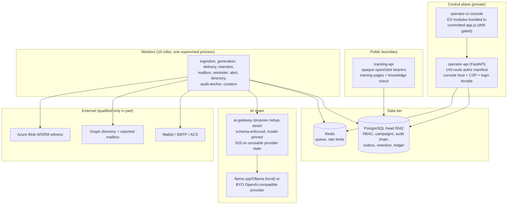

# Independent Adversarial Quality Review — 2026-10-07

**Scope:** full repository at `main` (post-remediation of `docs/QA-REVIEW-2026-10-05.md`,
per `docs/SESSION-HANDOFF-2026-10-06.md`), reviewed as an independent architect /
QA lead / security reviewer / end-user advocate. Method: systematic static
inspection of apps, packages, scripts, infrastructure, and docs; independent
execution of the project's gates (`make test`, `make lint`, `make typecheck`);
read-only live probing of the deployed `.105` stack over SSH (health, console
login, and read-only API GETs — no mutation); and re-verification of every
claimed 2026-10-05 remediation against live code. No code was modified.

**Release status is unchanged: NO-GO** for production and RSA Conference use.
Nothing in this review upgrades that decision.

---

# A. Executive Assessment

| Dimension | Score | Rationale |
|---|---|---|
| Architecturally sound? | **8/10** | A well-factored modular monolith (operator-api + tracking-api + multi-role worker + ai-gateway) with genuine module boundaries, transactional outbox/audit, deterministic policy layers, and pervasive fail-closed defaults. The prior review's boundary leak (worker→operator-api) is fixed and now test-enforced. Deducted for oversized modules (`console-js/app.js` 8.8k, `jobs.py` 3.0k, `campaigns.py` 2.5k) and one stale hardcoded role inventory in the status seam (N-01). |
| Feature complete? | **7/10** | Against the stated on-prem scope, the documented feature list is real code with real tests — verified claim-by-claim, including the previously-missing staleness surfacing (R-07) and the eight merged remediations. Deducted because every live-provider/browser/restore gate remains unproven, which is part of this product's own mission statement ("defensible outcomes", GUI-driven operation), and console status under-reports the worker fleet (N-01). |
| Production ready? | **3/10** | By the project's own evidence policy and independently re-confirmed: no live Azure/Entra/Graph/ACS qualification, no browser/WCAG pass, no D6 human acceptance, no exact-image/AMD64/registry attestation, no restore/rotation drill on the current `.105` topology. The code quality exceeds the evidence quality; the evidence rules. |
| Safe to use? | **7/10** | Security posture in code remains strong: OIDC with PKCE/issuer-pinning/DNS pinning, fail-closed RBAC with an enforced per-route manifest (now 143 routes), purpose-scoped keyed bearer verifiers, AES-GCM ciphertext, hash-chained audit, login throttling, hardened public edge, redacted logs. Deducted for the still-plaintext BYO key file (N-02) and a live deployment credential published in tracked docs of a **public** repository (N-07). |
| Maintainable? | **7/10** | Mechanical hygiene is excellent and independently reproduced: 3,515 hermetic tests pass in 208 s, ruff/format clean over 563 files, strict mypy clean over 190 source files, package-boundary and bundle-drift contract tests, explicit route-authorization manifest. Deducted for doc/count drift that recurred within one day of its last fix (N-03) and oversized modules. |
| Easy to use? | **5/10** | Unchanged from the prior review and deliberately deferred (UX Wave 2): engineering vocabulary in the console (Terraform stages, "occurrences", multi-verb launch), ~20 sidebar destinations, ~11 interactions for a first campaign. Setup wizard, probes, and fail-closed messaging remain above average. Browser behavior is **UNVERIFIED** in this review (no browser pass was possible from this host). |

**Bottom line:** the 2026-10-05 remediation cycle did what it claimed — all
eight landed fixes were independently found in code with tests, and the tree is
mechanically green by my own execution (not by copied counts). This is not a
facade over stubs. The remaining problems are (1) one genuine observability gap
I found fresh (N-01: two of ten worker roles are invisible to console status),
(2) two consciously deferred items that remain open risk (N-02 plaintext key
file, R-01 flake root cause), and (3) documentation that again states numbers
the tree no longer matches. The product remains correctly self-declared NO-GO.

---

# B. System Architecture (as actually implemented and re-verified)

Key properties re-verified in code and/or live this review:

- **Deterministic policy owns safety.** Generation output passes a strict
  contract; the allow-list sanitizer keeps only the training placeholder link;
  a human approves whatever survives; two-phase launch (canary → publish) is
  server-derived with provider/config-hash-bound evidence.
- **Prior QA fixes are real.** `classify_egress`/`provider_egress` derive
  offsite evidence from the actual base URL and record it in audit (R-02);
  the gateway returns `503 provider_state_unavailable` instead of silently
  substituting the local model (R-05); `apps/workers` no longer imports
  `kp_operator_api` and a boundary test fails closed if it returns (R-03);
  `KP_WORKER_SUPERVISE_SHARED_DB` exists with an actionable missing-var error
  (R-08); curation fetch failures log a warning naming the cause (R-11);
  the aggregation view carries staleness banners ("Generated …", "As of: …")
  (R-07 — the prior QA's miss, correctly called out in the handoff);
  `test_azure_idle_contract` failures now self-diagnose with rc/stdout/stderr/
  calls (R-01a).
- **Live stack on `.105` (deployed `main`)**: operator `/readyz` 200, tracking
  `/readyz` 200, console 200, Mailpit 200; console login succeeds; status and
  campaign list APIs return coherent data. **10 `kp-worker` processes run**,
  including `audit-anchor` and `curation` — see N-01.

---

# C. Requirements Traceability Matrix

Legend: COMPLETE (implemented + tested at local/static level) · PARTIAL ·
MISSING · BROKEN · IMPLEMENTED DIFFERENTLY · UNVERIFIED (exists; this review
could not prove live behavior).

| # | Requirement (source) | Expected behavior | Components | Status | Notes |
|---|---|---|---|---|---|
| 1 | Single-tenant install (README) | install → configure → start → use on macOS/Linux | `scripts/install.sh`, preflight, supervisor | **COMPLETE** (local) | Verified by reading + live stack; not re-run from scratch (**UNVERIFIED** clean-machine) |
| 2 | Deterministic RBAC with enforced route manifest | every route explicitly reviewed; fail closed | `kp_authorization`, `test_route_authorization_inventory.py` | **COMPLETE** | Manifest now covers 143 routes; doc count stale (N-03) |
| 3 | Entra-compatible OIDC + dev loopback mode | PKCE/nonce/state, exact iss/aud, DNS pinning | `auth.py`, `console_auth.py` | **COMPLETE** (local) | Live Entra **UNVERIFIED** |
| 4 | Signed RoE + frozen audience manifests | fail closed on wildcard/malformed/unicode domains | `sending_domains_roe`, campaign service | **COMPLETE** | |
| 5 | Two-phase launch: reviewed canary → separate publish | evidence bound to unchanged review | `routes/campaigns.py` | **COMPLETE** | Strongest-safety code in repo |
| 6 | AI generation via strict contract + model pin | bounded streamed JSON, pin fail-closed | `kp_contracts`, ai-gateway, `jobs.py` | **COMPLETE** (local) | Pin/fallback contradiction resolved (R-05 fix verified) |
| 7 | BYO generation providers | truthful egress evidence, protected keys, console selector | `ai_providers.py`, gateway state file | **PARTIAL** | Egress truth fixed (R-02 ✓); key file still plaintext (N-02) |
| 8 | Threat curation (forward-a-phish) | bounded MIME, deterministic clone, DRAFT only, visible failures | `curation_jobs`, `clone_service` | **COMPLETE** (local) | R-11 fix verified |
| 9 | Training pipeline (purpose-bound links → knowledge check) | purpose-separated bearers, idempotent completion, 72 h due | tracking-api, workers | **COMPLETE** | |
| 10 | Reporting: funnels, trends, named outcomes, CSV, ledger | denominator-explicit, capability-protected | `reporting.py`, analytics routes | **COMPLETE** | Staleness now surfaced (R-07 ✓) |
| 11 | Privacy/DSR + retention bounds | encrypted PII, single current notice, 365 d raw / 1,826 d ledger | `privacy.py`, retention jobs | **COMPLETE** | |
| 12 | Audit chain + dispatcher + WORM witness | hash chain, aggregate-only verification | `audit_store`, `audit_anchor_jobs` | **COMPLETE** (local) / **UNVERIFIED** (live WORM) | audit-anchor runs live but console status omits it (N-01) |
| 13 | Public tracking hardening | caps, duplicate CL rejection, trusted-proxy chain, no-store headers | tracking-api | **COMPLETE** | |
| 14 | Mail delivery: Mailpit / SMTP / ACS | pacing, correlation, receipts | worker providers | **UNVERIFIED** live | Mailpit path live-healthy; ACS code-complete only |
| 15 | Microsoft 365: Graph + reported mailbox | bounded delta/paging, replay, MIME guards | `microsoft365.py`, directory jobs | **UNVERIFIED** live | |
| 16 | Azure 3-stage deployment + GUI orchestrator | stage gates, digest-bound plans, delete refusal | `deployment_orchestration.py` | **UNVERIFIED** live | |
| 17 | Recovery / checkpoint / restore | snapshot chain, no-clobber publish | operator scripts | **UNVERIFIED** on current topology | Historical evidence only |
| 18 | Observability: health, redacted logs, bounded metrics | dependency-aware `/readyz`, central redaction | `kp_telemetry`, `runtime_status.py` | **PARTIAL** | `/readyz` good; console status omits 2 of 10 roles (N-01) |
| 19 | Browser console operable by non-engineers | plain language, progressive disclosure | `console-js/app.js` | **PARTIAL** / **UNVERIFIED** | UX Wave 2 deferred by design; no browser pass from this review host |
| 20 | Hermetic + profile test gates as evidence | deterministic, skip-free, reproducible | `run-hermetic-tests.sh` | **PARTIAL** | Hermetic re-run green; tool-dependent gates silently deselected (N-05); flake root cause still open (R-01b) |
| 21 | Honest documentation ("Release truth") | numbers match the tree | README, docs, root handoffs | **PARTIAL** | Count drift recurred (N-03) |

---

# D. Critical Findings

**No CRITICAL findings. No new HIGH findings.** The prior HIGH (R-01 evidence
flake) is partially resolved: its failure output is now self-diagnosing
(PR #125 verified), the flake did not reproduce in this review's full run, and
the root-cause removal remains a tracked deferral. All findings below are new
to this review or deliberately carried over.

### N-01 — Console status silently omits 2 of the 10 worker roles
- **Severity:** MEDIUM · **Component:** `apps/operator-api/src/kp_operator_api/console/runtime_status.py:86`
- **Problem:** the status payload hardcodes `("ingestion", "generation",
  "delivery", "retention", "mailbox", "reminder", "alert", "directory")` — 8
  roles. The platform now runs **10** (adds `audit-anchor`, `curation`; README
  and handoff both say ten). Verified live: `ps` on `.105` shows 10 running
  `kp-worker` processes, while `GET /api/v1/console/status` returns only the 8
  hardcoded keys.
- **Evidence:** live API response (2026-10-07) lists exactly 8 workers;
  `runtime_status.py:86` is a literal 8-tuple; no test pins the role list to
  `kp_workers`' actual roster.
- **Consequence:** the operator's "is everything OK?" screen shows all-green
  while the audit-head witness (`audit-anchor`, the tamper-evidence seam) and
  the curation worker can be dead. This is exactly the failure the product
  promises to surface. It also re-creates the count-drift class of bug inside
  code, where it is more dangerous than in docs.
- **Fix:** derive the probed role set from one shared constant (e.g.
  `kp_workers.roles.ROLE_NAMES`) imported by both the supervisor and
  `runtime_status`, and add a contract test asserting the status payload's
  `workers` keys == the supervisor roster. Display both new roles with
  plain-language labels ("Audit witness", "Threat curation").

### N-02 — BYO provider API key still written to disk in plaintext (carried R-04)
- **Severity:** MEDIUM · **Component:** `console/ai_providers.py::_write_state_file`
- **Problem:** the selected provider's key is decrypted into
  `data/run/ai-provider.json` (mode 0600) for the gateway. The DB column is
  properly `CipherText`; the live copy is plaintext and is captured by any
  backup/DR copy of `data/`. The 2026-10-06 cycle fixed the *documentation*
  ("treat `data/` as secret") and consciously deferred the code fix.
- **Consequence:** secret-at-rest exposure on the on-prem host; backup hygiene
  depends on an operator reading a doc line. Acceptable as a *declared*
  deferral only while the deferral is tracked — it is now the oldest open
  security item.
- **Fix (unchanged from prior review, still correct):** stop writing the key to
  the file (gateway fetches via a loopback/identity-scoped path or its own
  least-privilege DB role), or encrypt the file payload with the app KEK
  (versioned header). Unlink on `local` selection and on shutdown; state the
  residual exposure in backup guidance.

### N-03 — Documentation count claims drifted again within one day of repair
- **Severity:** LOW (doc integrity) · **Component:** `README.md`,
  `docs/architecture/README.md`, `docs/AI_HANDOFF.md`, `docs/REMEDIATION_PLAN.md`,
  `docs/NEXT_SESSION_HANDOFF.md`, `docs/WAVE-BUILD-PLAN.md`, root handoffs
- **Problem:** six documents claim "a reviewed manifest covers all **113**
  operator routes: 103 capability-protected and 10 dedicated/public". The
  enforced manifest (`test_route_authorization_inventory.py`) now covers **143**
  routes (132 capability-protected + 11 dedicated/public). Likewise
  `QA-REVIEW-2026-10-05.md` cites "3,506 tests" while this tree runs 3,515;
  root `QA_TASKS.md` and `RESUME-HERE.md` remain at repo root as archived,
  contradictory state (the planned `git mv` into `docs/archive/` never
  happened). The 2026-10-06 fix (#124) added an honest "as of" note but did not
  make the counts machine-checked, so they drifted as the route surface grew.
- **Consequence:** README is the first thing a new operator (or coding agent)
  reads; wrong numbers erode trust and misdirect agents. The project's own
  "Release truth" principle is violated by its own front page.
- **Fix:** the previously planned T-12 — replace hard-coded counts with
  generated references or "as of \<commit\>" phrasing, add the cheap contract
  test (README migration-head claim == `alembic heads`; route-count claim ==
  manifest length), and `git mv` the superseded root handoffs to `docs/archive/`.

### N-04 — Live deployment credentials and LAN topology published in a public repository
- **Severity:** MEDIUM (exposure; constrained impact) · **Component:**
  `docs/SESSION-HANDOFF-2026-10-04.md`, `docs/SESSION-HANDOFF-2026-10-06.md`
  (tracked), plus internal IPs/SSH details across `AGENTS.md`, `RESUME-HERE.md`,
  `RUNBOOK.md`, `README.md`
- **Problem:** the *live* console password of the currently deployed `.105`
  stack (value redacted here) is written in plaintext in two tracked handoff
  documents, and this repository is **public**. The same docs enumerate the
  internal host IPs, SSH user/port, deployment paths, and service topology.
- **Consequence:** anyone reading the public repo learns the admin password of
  the operator console and a map of the LAN. Actual reachability is constrained
  (console binds `127.0.0.1`; the box is behind SSH), and the data is declared
  disposable — so this is not CRITICAL — but the platform holds real recipient
  PII (encrypted) and simulates attacks against real people; a public password
  for its control plane is not defensible.
- **Fix:** rotate the console password on `.105`; remove credential literals
  from tracked docs (reference `data/` or a secrets manager instead); move
  host topology detail out of the public tree or into a private ops repo;
  consider a CI secret-scanning rule that fails on the live password pattern.

### N-05 — Hermetic evidence silently depends on host tooling
- **Severity:** LOW · **Component:** `scripts/run-hermetic-tests.sh`
- **Problem:** the gate deselects `requires_zsh`, `requires_node`,
  `requires_esbuild`, and `macos_only` tests when the tool is absent — including
  the console-bundle drift gate, which is the guard proving the served bundle
  matches the tested sources. A green run on a toolless host passes while
  silently omitting those guarantees; the summary ("111 deselected") does not
  say which gates were dropped.
- **Consequence:** evidence hygiene — two "green" runs are not equivalent.
- **Fix:** print the deselect reasons in the gate summary (and require the
  drift gate in CI where node/esbuild is provisioned, which is already the
  practice — make it explicit).

### N-06 — SQL built by f-string with an environment-supplied password
- **Severity:** LOW · **Component:** `scripts/bootstrap_local_parity.py:72-78`
- **Problem:** `ALTER ROLE {role} LOGIN PASSWORD '{password}'` interpolates
  `KP_DEV_RUNTIME_PASSWORD` directly into SQL; a quote in the password breaks
  the statement or alters it. `probe_url = database_url.replace("//kingphisher:", ...)`
  similarly breaks on `@`/`:` in the password.
- **Consequence:** dev-only, loopback-`kingphisher`-restricted bootstrap —
  contained. Still an avoidable injection-shaped pattern in a repo that is
  otherwise scrupulous about parameterization.
- **Fix:** use `ALTER ROLE ... PASSWORD %(pwd)s` cannot parameterize DDL
  passwords in psycopg; instead validate the password against a safe charset or
  use `psycopg.sql.Literal` composition; build the probe URL with
  `sqlalchemy.engine.url` objects rather than string replace.

### N-07 — `SourceType` enum advertises values the create API rejects (R-10's neighbor)
- **Severity:** INFORMATIONAL · **Component:**
  `packages/domain-models/models.py` (`advisory`, `curated`),
  `routes/sources.py:203` ("not implemented")
- **Problem:** the enum offers five source types; `POST /sources` accepts only
  `rss | stix | bulk_download` and errors with "not implemented" for the other
  two (which exist only via seeding/curation internals). The GUI dropdown is
  correctly limited to the three creatable values (verified — the historical
  BUG-1 is not present).
- **Fix:** either document the two internal-only values in the enum docstring
  or split the enum; make the error say "created automatically by threat
  curation" for `curated` instead of "not implemented".

### Carried, tracked (unchanged status)
- **R-01b (flake root cause)** — not reproduced in this review's full run
  (3,515 passed on a shared host); the diagnostic fix landed; root-cause removal
  stays deferred as recorded.
- **UX Wave 2** (two-button launch, checklist landing, stop consolidation) —
  deliberately deferred to the D3/D6 gate; see §H.

---

# E. Functional Gaps

**Required (the product cannot fulfill its mission without):**
1. Live-provider qualification: Entra OIDC, Graph delta, ACS delivery + Event
   Grid receipts, Outlook reported mailbox, DNS readiness (tracked; still the
   gating requirement for any real campaign).
2. Browser-qualified console pass incl. WCAG + human assistive technology (D3).
3. D6 human acceptance walkthrough — explicitly the pending on-prem sign-off.
4. Restore/rollback drill on the current `.105` topology (recovery code is
   proven only on the retired topology).

**Recommended (absence materially harms usability/reliability):**
5. Console status coverage of all 10 worker roles (N-01) — cheap, and it is the
   product's "is everything OK?" promise.
6. Key-file protection (N-02) before any backup/DR copy of `data/` is treated
   as non-secret.
7. Honest, machine-checked doc counts (N-03) before D6 (an operator reads the
   README during acceptance).
8. R-01b root-cause removal so evidence counts are trustworthy.

**Optional:**
9. Weekly outcome digest, recipient free-text search, combined pattern+draft
   review screen (prior review's optional tier; unchanged).

---

# F. Architecture Findings

1. **The boundary fix held.** `apps/workers` → `kp_operator_api` is gone and
   `test_package_boundary.py` fails closed on regression; `packages/curation`
   and `kp_domain_models.profile` are the right homes. Credit recorded.
2. **One remaining seam inconsistency (N-01):** the worker roster is defined in
   three places (supervisor spawn list, `runtime_status.py`, docs). Seams should
   share one source of truth; this is the last count-drift site in code.
3. **Oversized modules remain** (R-14 carried): `console-js/app.js` (8,842),
   `console/app.js` bundle (9,180), `jobs.py` (3,036), `campaigns.py` (2,540),
   `deployment_orchestration.py` (2,166), `models.py` (1,571). Not urgent; the
   drift gate makes the JS split safe when done.
4. **No overengineering detected.** One multi-role worker, one queue
   implementation (Redis), a transactional outbox, no unnecessary frameworks,
   no microservice sprawl. The Terraform-stage GUI surface remains the only
   complexity that arguably does not belong in an operator's console (§H).
5. **Dependency direction is clean** in the sampled import graph; contracts
   packages depend on nothing app-level.

---

# G. Security Findings (ordered by risk)

1. **N-04 (MEDIUM)** — live console password + LAN topology in tracked docs of a
   public repository. Rotate, redact, and secret-scan.
2. **N-02 (MEDIUM)** — plaintext BYO key in `data/run/ai-provider.json`
   (deferred R-04).
3. **N-06 (LOW)** — f-string SQL with env password in a dev-only bootstrap.
4. **N-07 (INFO)** — enum/API vocabulary mismatch for source types.
5. **Positives re-verified this review (no issue found):** no tracked secrets
   (`.env*` gitignored, `git ls-files` clean of key material); no hardcoded
   credentials in production paths (the one default password is documented,
   dev-only, and gated behind `KP_DEV_STACK` + dev posture); login throttling
   via `LoginThrottle` per client IP; dev HS256 identity refused in managed
   mode; `require_console_jwt_secret` enforces ≥32 bytes; the model-swap
   subprocess takes only a closed target set and a constant script path; worker
   exception handlers log bounded detail and re-raise (no swallowing found in
   the sampled `except Exception` sites); egress truth is now audit-derived from
   the actual base URL (R-02 fix confirmed in code + tests).

---

# H. UX Findings (carried from the prior review; deliberately deferred)

None of these were changed in the remediation cycle by explicit decision (UX
Wave 2 tied to D3/D6). Re-listed so the D6 walkthrough has them in view:

1. Terraform internals exposed in the console (stage names, digest-bound
   plans). *Simpler:* "Connect Azure → Validate → Deploy" with stages under an
   Advanced disclosure.
2. Six launch verbs. *Simpler:* two buttons — "Send test to canary" / "Send to
   everyone" — with the gate explained in one sentence.
3. ~20 sidebar destinations including power tools. *Simpler:* role-aware
   "What needs my attention" landing page; demote queues/model control/threat
   workbench to Advanced.
4. First campaign ≈ 11 interactions. *Simpler:* readiness checklist as landing
   view with inline per-step actions (zero new endpoints).
5. N-01 has a UX face: the status screen should show "Audit witness" and
   "Threat curation" rows so a two-person team can see what needs attention.
6. Dead-letter reasons now map to named error codes (R-05 fix) — verify the
   queue view renders them with remediation text during D6.

**UNVERIFIED:** all browser-rendered behavior (this review could not run a
browser against the console; HTTP-level flows were exercised live instead).

---

# I. Installation and Operations Findings

1. **Live-stack health independently confirmed** on `.105`: operator/tracking
   `/readyz` 200, console 200, Mailpit 200; console login and read-only API
   flows work exactly as the GUI drives them; 10 workers run under the
   supervisor (boot-persistent per handoff).
2. **`make test` is green end-to-end on the controller** (3,515 passed / 111
   deselected / 0 failures / 208.57 s) — the R-01 flake did not reproduce here.
3. **Install-from-scratch remains UNVERIFIED** in this review (read, not run).
   The installer's documented guards (disk headroom, preserved-volume identity,
   frozen lock, idempotent re-run) are present in code.
4. **N-05** — evidence equivalence between hosts is not guaranteed (tool-based
   deselection).
5. **Operations remain script-oriented** (git pull + restart marker; gateway
   restart by killing a systemd unit) — acceptable on-prem, tracked as a gap
   against "routine operation is GUI-driven".
6. **N-04** — backup/DR copies of docs and `data/` need the credential
   lifecycle documented (with N-02's key file in the same guidance).

---

# J. Testing Findings

1. **Executed this review:** `make test` → **3,515 passed, 111 deselected,
   0 failures** (208.57 s). `make lint` → ruff + format clean (563 files).
   `make typecheck` → strict mypy clean (190 source files). No skips leaked
   (the no-skips plugin is active).
2. **Not run here (UNVERIFIED):** PostgreSQL (92), Redis (2), fresh-migration
   (1), E2E (8) profile gates — they require Docker/remote engines. The last
   recorded profile runs predate the on-prem feature cycle; the prior review's
   T-16 re-run at head `0042` remains open and is correctly listed as pending
   (QA T-16) in README.
3. **Misleading-test risk (carried F10):** ~25 `test_*_ui_contract.py` files are
   substring assertions over console source; they catch deletions, not
   behavior. The behavioral net (Playwright specs) is excluded from `make test`
   and CI. A CI-able console behavioral smoke remains the top testing gap (T-14).
4. **Test blind spot matching N-01:** no test pins the `runtime_status` worker
   keys to the supervisor roster — the exact gap that let 2 of 10 roles go
   invisible. Add it with N-01's fix.
5. **Flake evidence (R-01):** one full clean run recorded this review; the
   self-diagnosing failure output (PR #125) is verified present. Definitive
   flake-rate data still needs the planned repeated loaded-host runs.
6. **Missing tests, prioritized:**
   - **P0:** supervisor-roster ↔ status-payload contract (N-01);
     gateway-state-file ↔ DB-selected-provider consistency (R-05 regression,
     already added — keep); egress-classification audit truth (added — keep).
   - **P1:** CI-able console behavioral smoke (T-14); repeated loaded-host runs
     of `test_azure_idle_contract` (R-01c).
   - **P2:** doc-claim contract tests (N-03: README route/migration counts);
     `bootstrap_local_parity` quoting (N-06).
   - **P3:** source-type vocabulary (N-07).

---

# K. Technical Debt (meaningful only)

1. N-02 key file (oldest open security debt; doc mitigation only).
2. Oversized modules (R-14 carried): 8.8k console module, 3.0k `jobs.py`.
3. Count claims in docs without machine checks (N-03) — third occurrence.
4. `MANAGE_ROLES` overloaded as the settings-admin capability (R-13 carried).
5. UI-contract test style (string greps) vs behavioral harness (carried).
6. KEK-in-Terraform-state and no rotation drill (documented debt; keep visible).

**Explicitly not debt (do not "fix"):** the committed bundle + drift gate; the
single multi-role worker; the console seam facade; the deterministic
clone/curation pipeline; the two-phase launch gate's strictness; the fail-closed
defaults everywhere they were sampled.

---

# Remediation Plan (executable waves)

Consolidates this review with the still-open items of the 2026-10-05 plan.
Each task is one PR-sized, verifiable, and none weakens a safety gate.

## Wave 0 — Truth and exposure (do first)

**Q-01 · P1 · Console status must cover every supervised role (N-01)**
- Problem: status omits `audit-anchor` and `curation`; all-green can lie.
- Files: `apps/operator-api/src/kp_operator_api/console/runtime_status.py`,
  new shared constant in `apps/workers/src/kp_workers` (e.g. `roles.py`) or
  `packages/domain-models`, `apps/operator-api/tests/test_console.py`.
- Instructions: define `ROLE_NAMES` once (10 roles) in a package both the
  supervisor spawn list and `runtime_status` import; replace the hardcoded
  8-tuple at `runtime_status.py:86`; render the two new rows with plain labels
  ("Audit witness", "Threat curation"); keep the existing probe semantics.
- Acceptance: `GET /api/v1/console/status` lists 10 worker keys matching the
  supervisor roster on a live stack; killing `worker-curation` flips its row.
- Tests: contract test `status_workers_keys == ROLE_NAMES`; existing
  `test_console.py` runtime-status cases updated.

**Q-02 · P1 · Remove the live credential from the public tree (N-04)**
- Problem: live console password + LAN topology in tracked docs of a public repo.
- Files: `docs/SESSION-HANDOFF-2026-10-04.md`,
  `docs/SESSION-HANDOFF-2026-10-06.md`, `RESUME-HERE.md`, `AGENTS.md`, `RUNBOOK.md`.
- Instructions: rotate the console password on `.105`; replace every credential
  literal with a reference ("the console password is in the `.105` keychain /
  `data/` secret store"); scrub SSH user/port/IP detail from the public tree or
  move ops topology to a private repo; add a CI grep gate that fails if the
  known password pattern (or any `KP_CONSOLE_PASSWORD=<value>`) reappears.
- Acceptance: `git grep` for the old password and for inline
  `KP_CONSOLE_PASSWORD=` values returns nothing tracked; console login works
  with the rotated password.
- Tests: a small `tests/test_no_credentials_in_docs.py` contract test.

**Q-03 · P2 · Machine-checked documentation claims (N-03)**
- Problem: "113 routes"/"3,506 tests"/root-handoff drift; third occurrence.
- Files: `README.md`, `docs/architecture/README.md`, `docs/AI_HANDOFF.md`,
  `docs/REMEDIATION_PLAN.md`, `docs/WAVE-BUILD-PLAN.md`, root `QA_TASKS.md`,
  `RESUME-HERE.md`; new contract test.
- Instructions: replace hard-coded counts with "as of \<commit\>" phrasing or
  generated references; state route counts once, derived from the manifest
  (143 = 132 + 11 today); `git mv` `QA_TASKS.md` and `RESUME-HERE.md` to
  `docs/archive/` keeping one handoff pointer at root; add contract tests:
  README migration-head claim == `alembic heads`, README route-count claim ==
  manifest length.
- Acceptance: the two contract tests fail if either number drifts; exactly one
  current handoff pointer at root.

## Wave 1 — Security debt

**Q-04 · P2 · Protect the BYO provider key file (N-02 / R-04)**
- Problem: plaintext API key in `data/run/ai-provider.json`, captured by backups.
- Files: `console/ai_providers.py`, `apps/ai-gateway/src/kp_ai_gateway/main.py`,
  `docs/OPERATOR-GUIDE.md`.
- Instructions: preferred (a) gateway fetches the key over a loopback- or
  identity-scoped path and the state file carries routing metadata only; else
  (b) encrypt the file payload with the app KEK (versioned header) and decrypt
  in the gateway. Unlink on `local` selection and on shutdown; document the
  residual exposure and backup handling (with Q-02's credential lifecycle).
- Acceptance: no reachable state of `ai-provider.json` contains a plaintext key;
  all provider presets round-trip; backup guidance names the file.
- Tests: round-trip tests + a test asserting the state file never contains
  `api_key` plaintext.

**Q-05 · P3 · Fix the dev-bootstrap SQL quoting (N-06)**
- Problem: f-string `PASSWORD '{password}'` and brittle URL replace in
  `scripts/bootstrap_local_parity.py`.
- Instructions: compose DDL with `psycopg.sql.Literal` (or validate the password
  to a safe charset and reject otherwise); build the probe URL from a
  `URL` object with `_replace(password=...)`.
- Acceptance: a password containing `'`, `@`, and `:` bootstraps cleanly or is
  rejected with a named error before any SQL runs.
- Tests: unit tests for both cases.

## Wave 2 — Evidence integrity (carried; unchanged intent)

**Q-06 · P2 · R-01b flake root-cause removal + load-tolerant contract tests**
- Reproduce `test_start_initialises_the_backend_too` under parallel load; fix
  the early-exit path in `azure-idle.sh start`; add a CI step running that file
  twice back-to-back. Acceptance: 10 consecutive full runs green on a loaded
  host (the self-diagnosing asserts from PR #125 stay).

**Q-07 · P2 · Print deselect reasons in the hermetic gate summary (N-05)**
- Acceptance: a run on a host missing node/zsh prints which gates were dropped;
  CI (which has them) prints none.

**Q-08 · P1 · CI-able console behavioral smoke (carried T-14)**
- Extend the Playwright smoke (login → readiness checklist → one benign
  mutation) against `docker-compose.e2e.yml`; `make test-console-smoke`; wire
  into CI with retained failure screenshots.

## Wave 3 — UX simplification (deferred by decision; schedule before D6)

**Q-09 · P2 · Two-button launch vocabulary; Q-10 · P2 · first-campaign
checklist landing; Q-11 · P2 · stop consolidation + Azure stage collapse under
Advanced; Q-12 · P3 · identity labels + named dead-letter remediation text.**
(Exact instructions unchanged from the 2026-10-05 plan T-08–T-11; each is
console-only with UI-contract updates in-PR.)

## Wave 4 — Release evidence (operator-gated; unchanged)

**Q-13 · P0 (release) · Re-run PostgreSQL/fresh-migration/Redis/E2E profile
gates at head `0042` on `.105` and record counts.**
**Q-14 · P0 (release) · D3 browser/WCAG + D6 human acceptance** (N-01's status
rows should land first so D6 sees the true fleet).
**Q-15 · P0 (release) · Azure staging re-qualification + exact-image/AMD64/
registry gate; restore/rollback drill on the current topology.**

---

# Plan self-review (per section 32)

**Senior architect:** Q-01 moves a constant, not a boundary — no redesign; it
unblocks Q-14's D6 (operator sees the real fleet). Q-02 is content-only. No
hidden dependencies; Q-04 depends on Q-02 only for the shared backup doc.

**Senior developer:** every task names exact files/lines and decision points
(Q-04 orders its two options; Q-01 names the shared-constant approach). Risk:
Q-01 touches both worker and operator packages — do it in one PR so the
boundary test and the status test land together.

**QA lead:** each task carries acceptance criteria and named tests; edge cases
covered (10-vs-8 roster, quoted passwords, count drift, loaded-host reruns).
Q-03's contract tests prevent the *third* recurrence rather than patching it.

**Security engineer:** no gate weakened; Q-02/Q-04 reduce exposure; Q-05
removes an injection-shaped pattern. One caution: Q-04 option (a)'s fetch path
must be loopback/identity-scoped — if that cannot be guaranteed, take option
(b).

**End user:** Q-01 and Q-09–Q-12 are the only user-visible changes; both make
the console say more truth with less vocabulary. Nothing adds configuration;
Q-02 removes a password from docs without changing how the operator logs in.

---

*End of review. No repository code was modified; this document is the only
artifact produced. Verified this review: `make test` 3,515/111 deselected/0
failures; `make lint` clean; `make typecheck` clean; live `.105` health/login/
read-only flows; all eight 2026-10-05 remediations present in code. UNVERIFIED:
browser/WCAG, live Azure/Entra/Graph/ACS, clean-machine install, PostgreSQL/
Redis/fresh-migration/E2E profile gates, restore drill.*
